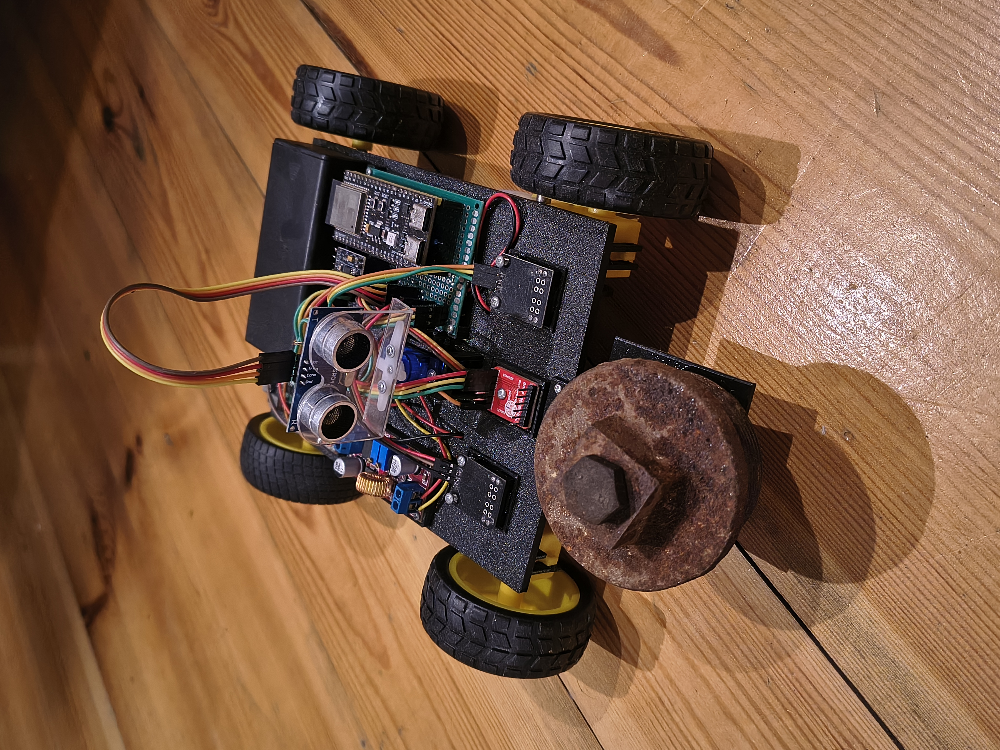
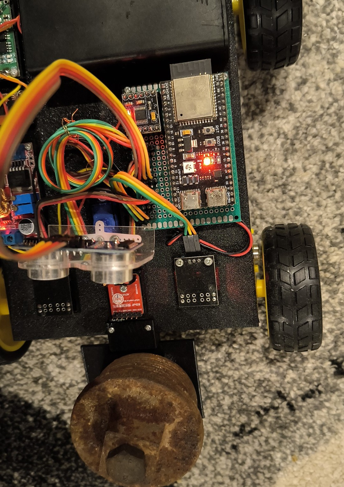
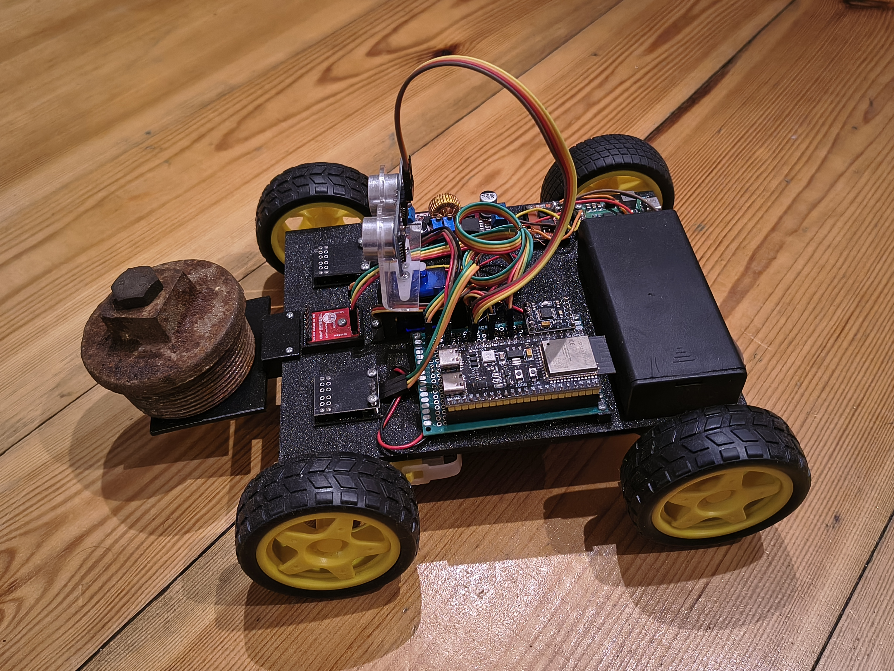
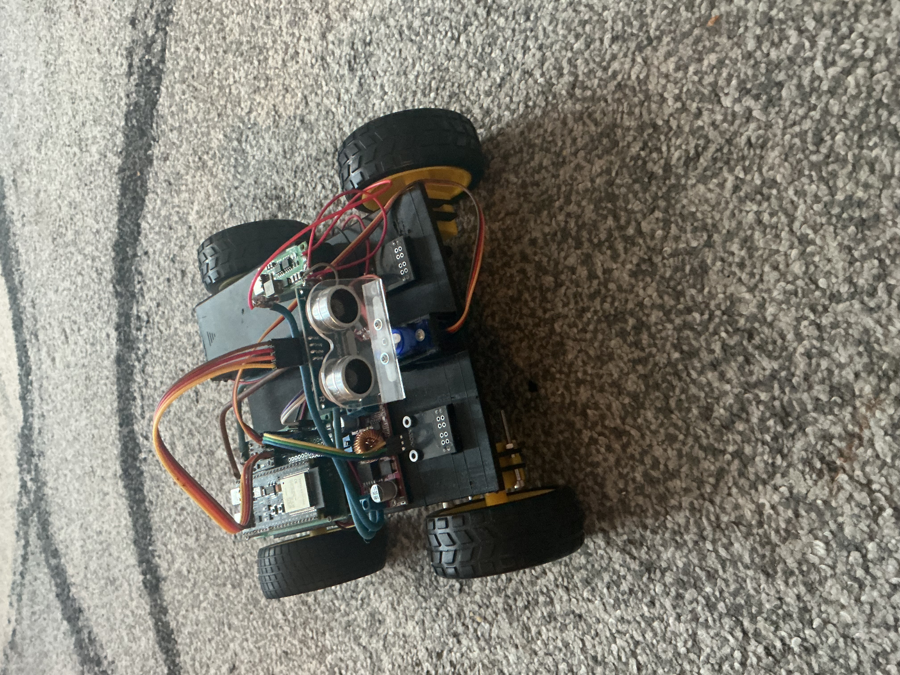
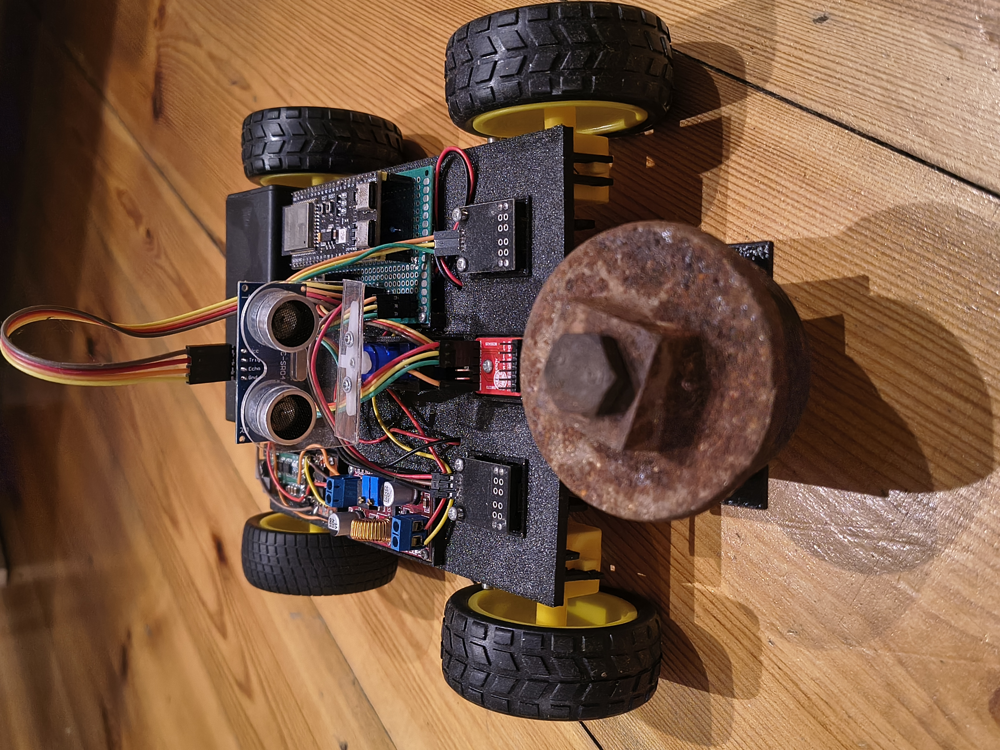
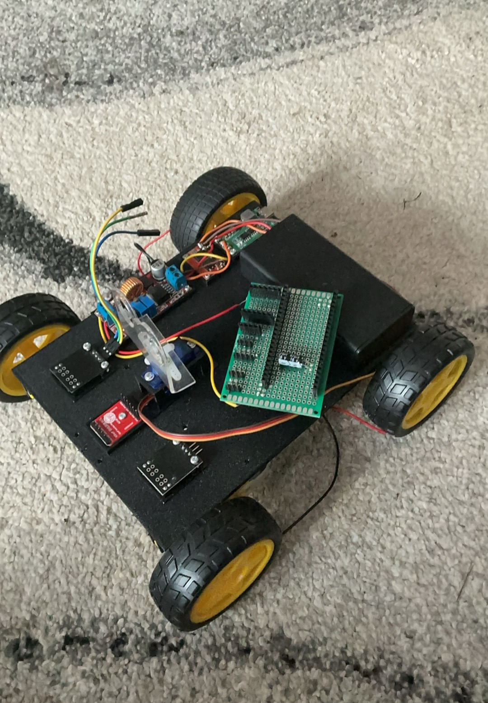

# ESP32-S3 Wheeled Robot

<p align="center">
  
  
</p>

https://github.com/user-attachments/assets/6468218a-55dc-4fcf-b27e-629400e1692d


A custom-built, front-wheel differential-drive robotics platform designed in **Autodesk Inventor** and programmed in **C++** for the **ESP32-S3**. The robot features custom power distribution, modular 3D-printed mechanics, odometry tracking, and wireless control via text commands over Bluetooth.

* **Code Documentation:** Full C++ documentation generated with **Doxygen** is available in the `docs/` directory.

---

## Hardware Architecture

The robot combines off-the-shelf electronic modules with a custom-soldered distribution board, dedicated battery protection, and 3D-printed mechanical parts.

<p align="center">
  
</p>

### Core Computing & Sensors
* **Microcontroller:** **ESP32-S3**. The firmware runs on a single-threaded super-loop architecture (without an RTOS or multi-core tasking), using hardware interrupts for time-critical encoder readings.
* **IMU (Inertial Measurement Unit):** **Bosch Sensortec BMI270 (I2C)**. A modern, low-power 6-axis inertial sensor chosen for reliable I2C communication and low noise.
* **Odometry:** **Dual Slotted Optical Interrupters** (photoelectric speed sensors) reading encoder disks mounted directly on the **motor shafts** to track individual motor rotations via hardware interrupts.

### Actuation, Drivetrain & Kinematics
* **Motors:** 2x **5V DC Micro Gearmotors** (48:1 reduction ratio) driving the front wheels independently.
* **Motor Driver:** **Texas Instruments DRV8833 Dual H-Bridge**. Chosen over legacy bipolar drivers (such as L298N) for its MOSFET-based architecture, minimal voltage drop, and built-in overcurrent/thermal protection. Controlled via PWM signals.
* **Drivetrain Configuration:** **Front-Wheel Differential Drive** paired with a passive rear axle. The rear wheels are identical to the front ones and rotate freely on **618/5 deep groove ball bearings**. Unlike standard 2WD robots with a caster wheel, the fixed passive rear axle prevents zero-radius (in-place) turns, resulting in car-like turning physics and lateral friction dynamics.

### Power Delivery & Integration
* **Battery Pack:** **2S Li-Ion** pack (2x 18650 cells in series, 7.4V – 8.4V).
* **Battery Management System (BMS):** Integrated **2S 10A BMS** module providing safe charging, over-discharge protection, and cell balancing.
* **Mainboard:** Modules and power lines are manually routed and soldered on a **50x70mm double-sided universal PCB**.

<p align="center">
  
</p>

---

## Software Architecture

The firmware is written in object-oriented C++ and runs in a single thread. It is structured around clear **Separation of Concerns**, splitting sensor acquisition, localization, communication, goal management, and motor control into dedicated controller classes:

```text
[Android BT App] ──▶ BluetoothController ──▶ GoalController ──┐
                                                              ▼
   [IMU & Encoders] ──▶ SensorsController ──▶ LocalizationController ──▶
		──▶ EngineController ──▶ [DRV8833 / Motors]
```

* **`SensorsController`:** Handles low-level reading of raw data from the BMI270 IMU and optical encoders.
* **`LocalizationController`:** Pulls raw sensor data from `SensorsController` and computes the robot's odometry (position and orientation).
* **`BluetoothController`:** Manages Bluetooth communication using a simple text-based command protocol, allowing the robot to be controlled from any standard Android Bluetooth terminal app.
* **`GoalController`:** Parses incoming commands from `BluetoothController` and defines sequential movement targets (goals) for the robot.
* **`EngineController`:** Combines target goals from `GoalController` with current odometry from `LocalizationController` to calculate and apply the appropriate power to the motors.

---

## Hardware Evolution & Design Iterations

Building a reliable mobile platform required solving several mechanical, manufacturing, and hardware issues across two prototype revisions.

### Prototype V1 (Proof of Concept)

<p align="center">
   
</p>

* **Architecture:** Monolithic, single-piece 3D-printed chassis with integrated standoffs and a quickly soldered perfboard.
* **Key Issues Identified:**
  * **Poor DFM (Design for Manufacturing):** Integrated standoffs eliminated flat base surfaces, requiring heavy 3D-printing supports. Any minor dimensional error meant scrapping and reprinting the entire ~100g chassis.
  * **Missing Power Integration:** The frame lacked dedicated mounting points for the BMS and charging module.
  * **I2C Hardware Failures:** Tested three separate **MPU-6050 (GY-521)** modules, none of which could be detected on the ESP32-S3 I2C bus.
  * **Unscalable Electronics:** The initial perfboard wiring was built solely for quick testing, making debugging and future expansion impractical.

### Prototype V2 (Modular & DFM-Optimized Redesign)

<p align="center">
   

   
</p>

* **Complete Mechanical Overhaul:** Redesigned from scratch in **Autodesk Inventor** with a focus on printability and modularity.
* **Intermediate Mounting Brackets (Tolerance & Cost Optimization):** Instead of bolting modules directly to the main chassis, components sit on small, separate 3D-printed adapters (~2g each). This solved three issues at once:
  1. **Rapid Tolerance Calibration:** Compensating for FDM thermal shrinkage on mounting hole spacing takes minutes on a 2g bracket instead of reprinting a 100g frame.
  2. **PCB Clearance:** Elevates electronic modules to provide safe clearance for bottom-side solder joints.
  3. **Support-Free Printing:** Keeps the main chassis plate flat, eliminating almost all print supports.
* **Electronics & Sensor Upgrade:** Rebuilt the mainboard from scratch and switched the IMU to the **Bosch Sensortec BMI270**, resolving all I2C detection issues.
* **Front Expansion Dock:** Added two standardized front mounting holes to dock additional modules (e.g., a future sensor expansion pack).

<p align="center">
   
</p>

---

## Real-World Debugging: Traction & Center of Mass (CoM)

During initial movement tests of Prototype V2, the robot suffered from severe **understeer and front-wheel slippage** when attempting to turn.

* **Root Cause:** Insufficient weight (normal force) over the front drive axle meant the driven tires could not overcome the lateral friction of the passive rear wheels.
* **Pragmatic Solution:** Used the newly added front expansion dock by designing a custom 3D-printed adapter to mount a heavy **cast-iron plumbing fitting** as front ballast. Shifting the **Center of Mass (CoM)** forward increased front-axle traction, restoring reliable turning performance.

---

## Future Roadmap (To-Do)

* [ ] **Active Obstacle Avoidance:** Software and hardware integration of the **HC-SR04 Ultrasonic Distance Sensor**.
* [ ] **Environment Scanning:** Mounting the HC-SR04 on an **SG-90 180° Micro Servo** for basic 2D distance scanning.
* [ ] **Custom PCB:** Designing a dedicated PCB in KiCad to replace the hand-soldered universal board.

---

## Repository Structure

```text
├── assets/             # Project photos and 3D printing GIFs for documentation
├── docs/               # Doxygen generated C++ documentation
├── robot/
│   ├── 3d_parts/       # CAD models (.ipt, .step, .stl) for chassis, brackets & adapters
│   └── src/            # ESP32-S3 C++ firmware source code
├── LICENSE             # MIT License
└── README.md           # Project documentation
```

---

## License

* **Software:** Licensed under the **MIT License** – see the [LICENSE](LICENSE) file for details.
* **Hardware (CAD/3D Models):** Shared under **CC BY 4.0**.
